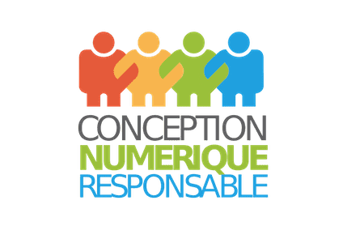

# EcoIndex

(English version below)

[EcoIndex](https://www.ecoindex.fr/) est un outil du
[Collectif Conception Numérique Responsable](https://collectif.greenit.fr/)

Ce dépôt contient le site web [www.ecoindex.fr](https://www.ecoindex.fr/), réalisé avec **[Astro](https://astro.build/)**.

## Contribuer

La contribution à l’ensemble de nos outils est ouverte à tout le monde, après s’être fait connaître du collectif.

Nous recherchons des personnes ayant des connaissances dans la tech, et dans le domaine de la traduction.

Pour faciliter les échanges, un channel **#ecoIndex** est dédié au projet sur le [Mattermost de l’association Green IT](https://chat.greenit.eco/).

### Licence

Le site internet www.ecoindex.fr, ainsi que les règles d’analyses et de calcul de l’ecoindex sont publiés [sous licence Creative Commons BY-NC-ND](LICENSE.md). Cela signifie que vous pouvez l’utiliser librement pour des utilisations non commerciales, à la condition de maintenir la paternité du contenu, via un lien vers https://www.ecoindex.fr

---

# EcoIndex

[EcoIndex](https://www.ecoindex.fr/) is a tool from the french
[Collectif Conception Numérique Responsable](https://collectif.greenit.fr/)

This repository hosts the [www.ecoindex.fr](https://www.ecoindex.fr/) website, built with **[Astro](https://astro.build/)**.

## Contribute

All of our tools are open to contributions from everybody, after having contacted the collective.

We seek people with technical skills, and people able to make translations and localizations.

There’s a dedicated **#ecoIndex** [Mattermost channel](https://chat.greenit.eco/) for the project.

## License

The website www.ecoindex.fr, as well as the ecoindex analysis and calculation rules are published [under Creative Commons BY-NC-ND license](LICENSE.md). This means that you can use it freely for non-commercial uses, on condition that you maintain the authorship of the content, via a link to https://www.ecoindex.fr
